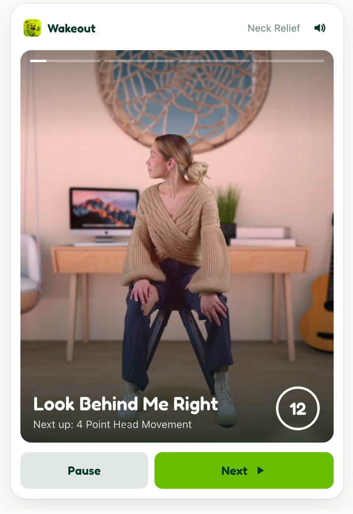

# Wakeout for Claude

Sitting too long? Ask Claude for a movement break and Wakeout plays one right in the chat. A guide shows each move on video while a timer counts down, and you follow along. One minute by default (four moves, 15 seconds each), up to ten if you ask. Seated or standing, at your desk, in 16 languages. Free, no account, no sign-in.

## What's in this plugin

- **A skill, `movement-break`**, that tells Claude when a break fits (sitting too long, a stiff neck or shoulders, an afternoon slump, a break between meetings or Pomodoros) and how to pick seated or standing, the focus, the language and the length.
- **The Wakeout connector**, a remote MCP server at `https://mcp.wakeout.app/claude` with one read-only tool, `start_movement_break`, which opens the Wakeout player.

Things to try:

- "I've been sitting all morning. Give me a quick movement break."
- "My neck is stiff from my laptop. Something I can do in my chair?"
- "Pomodoro done. Start a two-minute standing break."
- "Dame una pausa activa de un minuto, de pie."

## What it sends and loads

This plugin runs no code on your machine. When Claude starts a break:

- Claude sends the Wakeout server (`mcp.wakeout.app`, hosted on Railway) the details of the break: sitting or standing, what it should help with, the language, the length if you asked for one, and a few words describing the break. Never your conversation, name, email or Claude account.
- The player loads the exercise videos and images from Wakeout's CDN (`d350zw5py31jpl.cloudfront.net`, Amazon CloudFront) and its fonts, sounds and images from `mcp.wakeout.app`.
- The player sends anonymous usage events (for example a break started or finished) with a random identifier it keeps in its own storage to `mcp.wakeout.app`, which forwards them to PostHog so we can count them.
- Tapping the Wakeout brand or "More breaks at wakeout.app" opens `https://wakeout.app`.

Full details: [privacy policy](https://wakeout.app/privacy#claude). Docs: [wakeout.app/claude](https://wakeout.app/claude).

Wakeout breaks are gentle everyday movement for people who sit a lot. They aren't a training plan, a medical or rehab program, or advice for an injury.

## Support

Write to hello@wakeout.co or visit [help.wakeout.app](https://help.wakeout.app).

## License

MIT, see [LICENSE](LICENSE).
